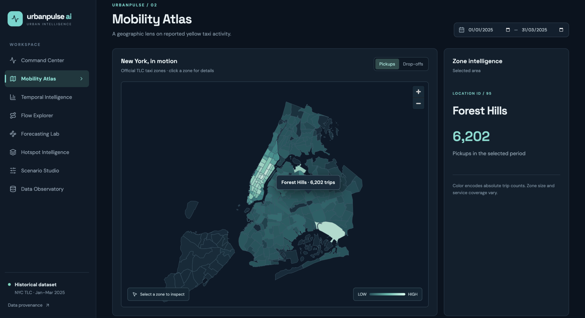

# UrbanPulse AI

**UrbanPulse AI – A Spatiotemporal Urban Mobility Intelligence and Interactive Digital Twin Platform** is an academic visual analytics prototype by Shivaya Pandey (RA2311056010032), for 21CSE423T — Big Data Visualization, under Dr. Varun P. It explores historical New York City yellow taxi trips, January–March 2025. It is not a live traffic feed or a validated real-time digital twin.

**Public source:** https://github.com/shivayapandey/urbanpulse-ai

**Live application:** https://urbanpulse-ai-beryl.vercel.app  
**Backend API:** https://urbanpulse-ai-api.onrender.com/api/health

## Explore

- **Command Center:** trip counts, daily trend and leading pickup zone.
- **Mobility Atlas:** interactive official taxi-zone map; switch pickups and drop-offs.
- **Temporal Intelligence:** daily and hourly trends and weekday/hour heatmap.
- **Flow Explorer:** ranked directed origin–destination pairs and zone-center connections.
- **Forecasting Lab:** one-hour-ahead gradient boosting compared with a weekly seasonal baseline.
- **Hotspot Intelligence:** descriptive K-means groups of normalized daily pickup profiles.
- **Scenario Studio:** hypothetical proportional adjustments to observed pickup counts.
- **Data Observatory:** quality rules, retention and source limitations.



## Architecture and evidence

React/Vite and MapLibre provide the interface; FastAPI exposes read-only endpoints over precomputed DuckDB aggregates and Parquet forecasts. The pipeline uses pandas and scikit-learn. The repository includes the **full aggregate database used by the application**, official zone boundaries, forecast outputs and trained model; it does not include the much larger trip-level raw or cleaned data. The interactive date filters and routes use the original complete aggregates, not sampled or synthetic records.

Official [NYC TLC trip record data](https://www.nyc.gov/site/tlc/about/tlc-trip-record-data.page) and taxi zone boundaries are the source. There were **11,198,026 raw records**, **10,776,622 retained**, and **421,404 excluded by one or more overlapping plausibility rules**. The March 2025 holdout contains 744 hours; model MAE was **381.46 pickups/hour**, compared with **557.42** for the same-hour-previous-week baseline. Four February expanding-window tests provide additional evaluation. See [dataset selection](docs/dataset-selection.md), [methods](docs/methods.md), and `data/processed/quality.json` for provenance, exclusions and limitations.

## Local setup

Requires Python 3.11 and Node.js 20. From the repository root:

```bash
python3 -m venv .venv
source .venv/bin/activate
pip install -r requirements.txt
uvicorn backend.main:app --host 127.0.0.1 --port 8000
```

In another terminal:

```bash
cd frontend
npm ci
npm run dev
```

Open <http://127.0.0.1:5173>; Vite proxies `/api` to the local backend. Health: <http://127.0.0.1:8000/api/health>. For an external backend, set `VITE_API_BASE_URL` to its origin before building; configure the backend's `CORS_ORIGINS` as a comma-separated list of allowed frontend origins. Set `OMP_NUM_THREADS=1`, `OPENBLAS_NUM_THREADS=1` and `MKL_NUM_THREADS=1` on memory-constrained hosts.

Run checks from the repository root:

```bash
python -m unittest discover -s tests -p 'test_api.py' -v
cd frontend && npm run build
```

For the optional browser walkthrough, install `pip install -r requirements-dev.txt` and `python -m playwright install chromium`, start both services as above, then run `python tests/browser_smoke.py` from the repository root. Set `URBANPULSE_URL` to test another deployment or `CHROME_PATH` to use an installed Chrome binary. `tests/audit_results.py` additionally requires the trip-level Parquet files, which are not included in the repository.

## Deployment

`render.yaml` defines a **free** Render Python web service; it binds to `0.0.0.0:$PORT`. Connect this repository as a Render Blueprint and set `CORS_ORIGINS` to the final frontend origin. The service reads its versioned files from the deployment; it does not require a persistent disk. Render free instances can sleep after 15 minutes without traffic and take roughly a minute to wake. This deployment uses manual deployment triggers; pushes to GitHub do not automatically update the live services. The fixed date range and precomputed model results are historical, not a live prediction service.

Create a Vercel Hobby project with root directory `frontend`, Vite build command `npm run build`, output directory `dist`, and `VITE_API_BASE_URL` set to the Render origin. Add the resulting Vercel origin to Render's `CORS_ORIGINS`, redeploy both as needed, and verify the public site and `/api/health`. A local proxy is only used in development. See [Render free limits](https://render.com/docs/free) and [Vercel Hobby limits](https://vercel.com/docs/plans/hobby); confirm account terms and costs before selecting any paid plan.

## Reproducing data and limitations

`src/pipeline.py` is the original processing pipeline. To rebuild, obtain the three official monthly Parquet files in `data/raw` and install the broader pipeline dependencies listed in that script and documentation; stop running services before replacing generated data. Downloading or processing source files is **not** required to run the included dashboard. Source vendor records are imperfect and represent yellow taxis, not all travel. Counts are absolute, not population- or area-normalized. Local wall-clock timestamps have daylight-saving limitations. The short evaluation is not evidence of general forecast performance; each one-hour prediction assumes prior actual counts are available. Clusters are descriptive profiles, not statistical hotspot tests. Scenario values are arithmetic illustrations, not causal estimates or forecasts. Straight flow lines join zone bounding-box centers rather than road routes.

The model is a Python joblib artifact: load it only from a trusted source with compatible dependencies. Signature or faculty approval is not implied by this repository.
